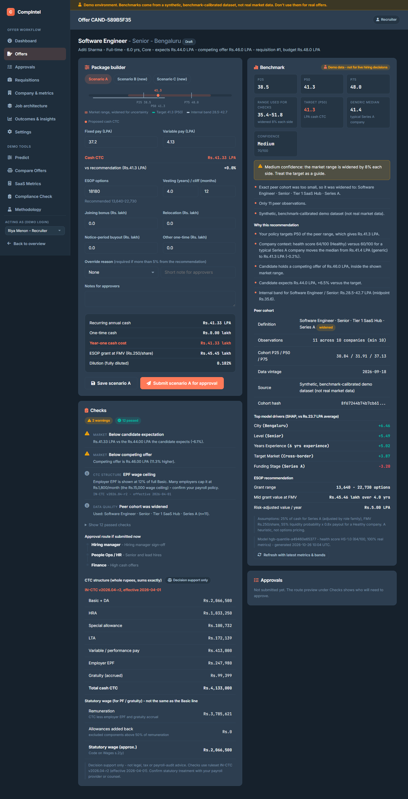
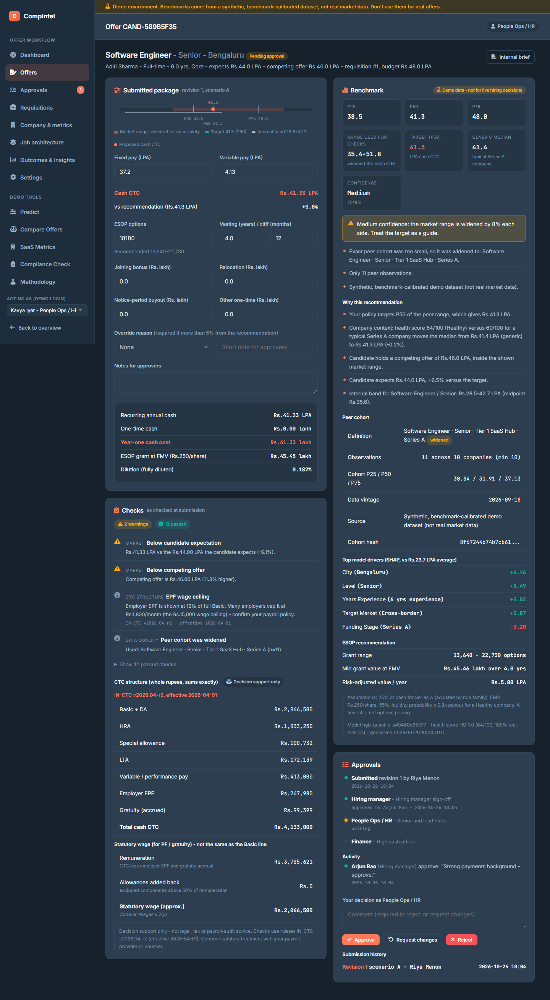
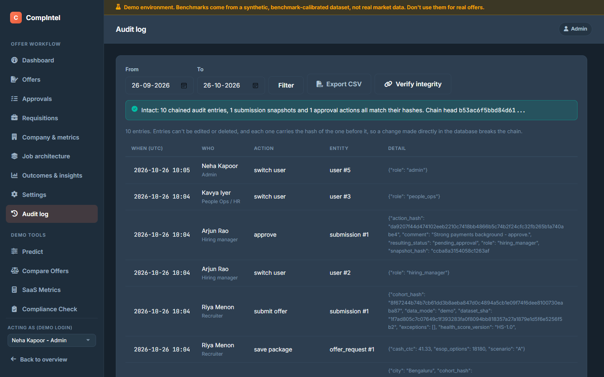

# CompIntel — India SaaS Compensation Intelligence

An offer workflow for recruiters at Indian SaaS companies. It predicts a **market cash
CTC range (P25/P50/P75)** for the role, then **positions the offer inside that range**
using the hiring company's computed unit economics (ARR, NDR, LTV:CAC, Rule of 40):
what it can afford, and how much of the package to carry in ESOP. Checks, approvals,
candidate summaries and outcome tracking sit around it.

**Company health never moves the market range.** A weak company doesn't change what the
market pays a Senior engineer in Bengaluru; it changes what the company can afford. So
health is not a model input. It sets the target percentile and the cash/ESOP tilt.

## Overview

- **Problem:** Indian SaaS compensation depends on factors generic salary data
  doesn't capture: cross-border vs. domestic target market, funding stage, and the
  cash/ESOP mix. Two companies at the same funding round can have very different
  ability to pay, even though the market they hire from is the same.
- **Approach:** A quantile gradient-boosting model, trained on a benchmark-calibrated
  synthetic dataset, predicts the market range from role, experience, city, stage,
  target market, skill, pedigree and pricing model. Separately, `saas_metrics.py` turns
  a company's raw numbers into a health score, and `pay_positioning()` uses it to pick
  the target percentile and ESOP tilt (an authored policy heuristic, switchable in
  Settings).
- **Output:** A P25/P50/P75 market range (LPA), a health-adjusted target, a separate
  ESOP estimate (paper FMV and a risk-adjusted expected value), a statutory CTC
  breakdown, a compa-ratio, and a SHAP explanation of the market range.

## Public website and brand (Website & Brand PRD v1.0)

`marketing.py` (blueprint `mk`) serves the public site; `templates/site/` holds its pages.

| Page | Notes |
|---|---|
| `/` | Hero "Make the right offer before it costs you the hire—or your runway", with a **live offer-decision card** (demo model, labelled) and a 4-field sample form |
| `/sample-benchmark` | The primary conversion. Role, level, city, stage, then P25/P50/P75, **Conservative / Recommended / Aggressive** packages (cash, about-percentile, ESOP, annual cost, burn, runway, plan variance), the trade-off sentence, why the recommendation differs from the median, and optional company numbers (not stored) |
| `/india-ctc` | CTC breakup, statutory wage, employer cost and a **take-home estimate** (`workflow/take_home.py`, new regime FY2025-26 slabs, versioned) |
| `/esop-scenarios` | Grant as options or %, strike, FMV, dilution, Conservative/Base/Upside, exercise cost, underwater flag |
| `/product`, `/benchmarks`, `/for-founders`, `/for-people`, `/pricing`, `/security` | Content per PRD section 10 |
| `/pilot` | Pilot application (work email required, consent, CSRF). Admins see applications and funnel counts at `/app/pilot-applications` |
| `/privacy`, `/terms`, 404 | Privacy and terms are **drafts marked as pending legal review** |

Brand: `static/css/brand.css` defines the navy `#0B1F3A` / teal `#0E7C7B` / amber `#F2A93B` tokens and re-maps the old
dark theme's tokens, so the `/app` workflow uses the same light, navy-sidebar identity. Coral, green and amber get
darker *text* tones to meet 4.5:1 contrast; the exact brand hexes are used for fills. Inter with tabular figures, and
JetBrains Mono for IDs and rule versions. Logo "Offer Compass" (three inputs converging on an amber decision node) in
`static/images/compintel-mark*.svg` (primary, reversed, mono) plus a lockup. Line icons (1.5px, 24px grid) are in
`templates/site/_brand.html`. Rupee amounts use Indian digit grouping (12,34,567). Site events (`site_events`) carry no
IP, user agent or free text. Bounce rate and time on page need a separate analytics tool.

The old landing page `templates/index.html` is no longer served (its content lives on `/about-tech` and in the footer's
Methodology lab links). The `/app` screens still use Font Awesome icons rather than the new line-icon set.

## Methodology lab (standalone tools)

These grew out of the internship and course work. They're not part of the recruiter
workflow, so they live under **About & methodology** (`/about-tech`) rather than in the
main navigation.

| Page | What it does |
|---|---|
| `/predict_form` | Model explorer. One profile in; the market range, SHAP drivers and a **health what-if slider** out. The slider leaves the market range alone and shows how health moves the target percentile, the target cash and the ESOP tilt (`/api/predict`). |
| `/compare` | The same profile at two companies (funding stage, target market, pricing model). A candidate-side view, kept for methodology. |
| `/saas-metrics` | The course-content calculator: raw company numbers in, every formula (ARR, CAC, LTV, NDR, Rule of 40, Magic Number, TAM/SAM/SOM) out. |
| `/compliance-check` | Check an already-decided Basic/HRA/EPF/Gratuity breakup against the Code on Wages conventions the workflow also uses. |

## Offer workflow (`/app`) — PRD MVP, demo only

The predictor above is one step in a full offer workflow, built to the CompIntel PRD's
MVP scope and mounted at `/app`. **It is a demo, not production compensation software.**
Benchmarks come from the synthetic dataset, every benchmark card says "Demo data — not
for live hiring decisions", and every PDF or candidate summary made from demo data is
watermarked.



**Try it:** `python main.py`, open `http://127.0.0.1:5000/app`, switch to *Neha Kapoor —
Admin* in the sidebar's "Acting as" menu and click **Load the demo workspace**. Then switch
roles to walk an offer through: Recruiter creates and submits it → Hiring manager → People
Ops → Finance approve → Recruiter exports the candidate summary and records the outcome.

| Step | What happens | PRD refs |
|---|---|---|
| Onboarding | Role-specific "Getting started" checklist. A recruiter starts with **importing past offers** (paste or CSV) and a **first benchmark that needs no metrics**, and asks Finance for metrics with **one click** (Finance gets a notification; saving metrics closes the request and tells recruiters). Per-user first-run state, a dismissible welcome guide, and **time to first benchmark** measured against a 10-minute target. | - |
| Company & metrics | Profile + ARR/NDR/churn/CAC/LTV/margin/headcount, by form or CSV. Every save is an immutable snapshot. Missing metrics fall back to the funding-stage default *per health-score component*, and the page shows which components are real. Metrics only affect the target position, never the market range. | CP-01–06 |
| Job architecture | Internal bands per role / level / city tier (manual, or seeded from the demo data). | BM-04 |
| Requisition → offer request | Role, level, city, employment type and budget preload from the requisition; candidate gets a pseudonymous ID. A benchmark is generated and stored. | OB-01 |
| Benchmark | P25/P50/P75 market range, a target at the policy percentile shifted by company health (+10 Hypergrowth/Efficient, 0 Healthy, −10 Cash-constrained, −15 At-risk), peer cohort (definition, n, companies, data date, cohort hash; widened if below the minimum size), SHAP drivers, ESOP grant range with dilution (tilted up 25% when cash is tight). | BM-01–08 |
| Confidence | Scored with one plain reason per deduction ("Only 11 peer observations", "NDR missing", "Benchmark data older than 90 days", "Level is inferred…"), and it **changes what's shown**: High = full range + target; Medium = range widened 8% + caution; Low = broad band only, no target, recruiter must acknowledge; Insufficient = no recommendation, manual entry with a reason. | BM-02, §10.3 |
| Package builder | Fixed/variable, ESOP options + vesting/cliff, joining bonus, relocation, notice buyout, other one-time. Up to three scenarios with a side-by-side view. Live range marker, cost maths and server-side checks as you type. | OB-02–07 |
| Checks | Market, override reason, internal band, internal parity, budget, affordability (cash-tight company paying above the median), ESOP, CTC structure, statutory wage, data quality. Each is pass / info / warn / exception (adds an approver) / block. | CR-01–05, OB-05–06 |
| Approvals | Configurable rules. Route and full snapshot frozen at submission. Approve / reject / request changes / comment; revisions kept. **Whoever submitted an offer can't approve it**, even with the right role. | AP-01–05, OB-08 |
| Briefs | Internal approval PDF; candidate summary (HTML + PDF) built only from the package. If the package has CTC warnings, someone must acknowledge them (audited) before the candidate summary can be exported. | OF-01–02 |
| Outcomes & calibration | Outcomes for in-app and outside offers (form or CSV). With consent on, an anonymised copy goes to the benchmark network. Insights: acceptance rate and model P25–P75 coverage by role, level, city, **company health band**, employment type, source. | OF-03–06 |
| Admin | Users and roles, workspace data mode, policy, approval rules, data-sharing consent, retention purge, audit log with hash-chain verification and CSV export. | §6, AP-05 |

### Definitions that matter

- **Internal parity** compares against accepted offers for the *same role, level, city
  and employment type* only, shows the group size, and is suppressed below 3 (configurable).
  It's a like-for-like offer comparison, **not a pay-equity analysis**.
- **CTC structure vs statutory wage.** The breakup (Basic, HRA, allowances…) is a
  structure. The PF/gratuity wage base under the Code on Wages s.2(y) is Basic + DA plus
  any excluded components above 50% of total remuneration; it's shown separately and can
  differ from the Basic line. Every CTC result is labelled *decision support only* and
  linked to its ruleset version (`IN-CTC v2026.04-r2`) and effective date.
- **Workspace data mode** (`demo` / `pilot` / `production`, admin only). Only `demo` runs
  the synthetic model. In `pilot`/`production` benchmarks come from **observed, consented
  offers** (see V2 below) and are *Insufficient*, with manual entry and a reason, until a
  cohort clears the privacy thresholds.

### V2: real-data pilot (PRD v2.0)

| Area | What was added | PRD refs |
|---|---|---|
| Observed-offer benchmark | `workflow/pilot.py`. In pilot/production, P25/P50/P75 are empirical quantiles of **accepted** offers in the benchmark network. Declines, withdrawals and counters for the same cohort are shown as context, not used for the range. Thresholds: `min_cohort_size` offers **and** `min_contributors` companies (default 10 and 3), with a `pilot_lookback_months` window and the same widening ladder as the demo engine. Confidence also drops for few contributors or old data. The exact rows are hashed and their IDs frozen, so **Verify reproducibility** re-derives the range from them. | §8.1, BM-02/09, AP-06, §12.3 |
| Benchmark data network | `/app/network`. An admin imports anonymised design-partner offers (CSV per §11.2) with a required consent basis and attestation. Company refs are salted-hashed; rows hold bands, never names. Duplicate files and rows are refused, one bad row rejects the batch, and **Remove batch** is the partner deletion workflow. | §11.1–11.4 |
| Affordability & runway | Cash in bank, monthly burn, annual new-hire budget and planned hires join the versioned metrics (never the health score). Every package shows annual and monthly cost, runway before and after, variance against the average per planned hire, and a **P25/P50/P75 cost table** (what moving from P50 to P75 does to runway). Falling below `runway_floor_months` raises a budget exception routed to Finance; a cut over `max_runway_impact_months` warns; missing cash or burn lowers confidence and warns. | AF-01–08 |
| ESOP scenarios | `workflow/esop.py`. Strike price per package; exercise cost; ownership before and after future dilution; Conservative/Base/Upside exits (multiples of FMV, configurable) with an illustrative flat-tax net; underwater flags. Shown in checks, the internal PDF, and the candidate summary (package-only wording). | ES-01–07 |
| Offer-outcome telemetry | Outcomes record the initial offer (the approved package, for in-app offers), the candidate's cash and ESOP counter, and a *Timing / start date* decline reason. CSV import accepts the four extra columns (older files still work). Shared observations carry the telemetry. Insights adds counter rate, median counter ask, final vs initial, decline-reason capture, and a **Pilot readiness** panel against the Phase 1 exit criteria. | §9.3, OF-03–07, §18 |

Migration 004 rebuilds `benchmark_observations` (existing rows kept, tagged as workspace
outcomes), adds `network_import_batches`, and adds initial/counter columns to `outcomes`.

Still open from the PRD: external audit-hash anchoring (AP-08), candidate take-home (CT-05),
SSO, PostgreSQL, and the §19 open questions. The thresholds and ESOP exit multiples are
configurable defaults, not answers to those questions. ATS/HRIS integrations now have a
receiving side (V3 below), but no adapter has been tested against a live vendor account.

### V3: real-time data layer

Four pieces that move the benchmark from static tables towards live, outcome-driven data.
Migration 006 adds `integration_connections`, `offer_events`, `cohort_snapshots` and
`outcomes.source_ref`.

| Area | What it does | Where |
|---|---|---|
| **A. HRIS & ATS integrations** | Signed webhook receiver (`POST /api/v1/integrations/hooks/<key>`) with adapters for Keka, Darwinbox, greytHR, Zoho People (payroll), Greenhouse, Lever, Freshteam (offers), and the Merge.dev / Finch unified APIs. Every payload is mapped to one PII-free `OfferEvent` (role_id, role, level, city, fixed/variable CTC, ESOP grant, stage, status, timestamp). A delivery is idempotent, an offer moving sent → accepted updates the same outcome, and a late "sent" can't downgrade it. Raw payloads are never stored, only their SHA-256. Non-INR amounts, unmapped titles and cities outside the model are **rejected with a reason, never guessed**. HRIS payroll counts as an offer only for recent joiners: incumbent pay isn't an offer price. Admins get per-connection field-map overrides, a dry-run payload preview, signed test events and a delivery log at `/app/integrations`. | `workflow/integrations/` |
| **B. Streaming percentiles** | Recording an outcome (form, CSV, webhook) or importing/removing partner data queues the affected cohort (role · level · city tier · stage). After the request commits, a worker recomputes rolling-window (default 90 days) P25/P50/P75 with recent offers (default 30 days) weighted 2x. The weighted quantile reduces exactly to `PERCENTILE_CONT` with equal weights. It stores an append-only snapshot and pushes it over Server-Sent Events to every open `/app/market` page. Privacy thresholds (min offers, min companies) apply to every live number. Event bus: in-process coalescing worker by default; `COMPINTEL_STREAM_BACKEND=redis` + `COMPINTEL_REDIS_URL` uses Redis Streams (consumer group, ack, redelivery) and pub/sub across processes. | `workflow/streaming.py`, `/app/market` |
| **C. CTC rule engine** | Indian CTC rules are versioned JSON (`rulesets/in_ctc/2026.04-r1.json`, `-r2.json`): percentages, tolerances, severities, metro list, rule order. `ctc_engine.py` (Flask-free) selects by version or effective date and evaluates; the offer checks, `ctc_rules.py` and the API all use it. `POST /api/v1/ctc/validate` is stateless (auto-structure from cash + variable, or validate an already-decided breakup); `GET /api/v1/ctc/rulesets` lists versions. The CTC structure check page has a live slider that calls the API on every move. | `ctc_engine.py`, `rulesets/` |
| **D. Clearing price** | From accepted **and** declined offers (a negotiated acceptance counts its opening offer as a decline; a counter counts as a half-weight acceptance at the asked price), a weighted isotonic regression fits P(accept \| offer). It reports the clearing price (50% acceptance), the price for a target close rate (default 80%), and the decline rate for an offer at the **benchmark P50** (the 24-month accepted-offer P50 recruiters anchor on), with the trend against the previous window. At or above the alert threshold (default 50%) the cohort raises a one-time notification to Recruiter, Finance and Exec. The offer builder warns when a package is below the clearing price. Only acceptance at fixed multiples of P50 is shown, never individual offer amounts. | `workflow/clearing.py` |

Why the alert anchors on the long-horizon P50 and not the live one: when candidates' asks
rise, only the higher offers get accepted, so accepted-offer percentiles drift up with the
market and hide the very shift the alert exists to catch.

**Demo:** in a demo workspace, an admin can click *Load synthetic market sample* on
`/app/market`. It adds 300 clearly labelled synthetic partner offers (a removable batch under
Benchmark data) where the Software Engineer · Senior · Tier 1 market moves up 22% in the last
two months. Then use *Send signed test event* on `/app/integrations` and watch the market
page update without a reload.

**Caveats.** Vendor field paths and signature schemes come from public documentation and
**haven't been tested against live accounts**. Keka, Darwinbox, greytHR and Zoho People don't
publish signed webhooks for pay data, so records from them are forwarded and signed with the
connection secret (`X-CompIntel-Signature: sha256=<hex HMAC of body>`). Lever's native webhook
signature covers only `token + triggeredAt`, not the body, so Lever offers are forwarded and
signed the same way. Benchmark observations are month-granular (privacy), so the 90/30-day
windows treat each offer as mid-month. Under gunicorn, SSE needs threaded or async workers
(`gthread`/`gevent`), and the in-process bus only reaches pages served by the same process;
use the Redis backend for more than one. Webhook ingestion follows the same
`COMPINTEL_DEMO_MODE` switch as the rest of `/app`.

### Integrity

- Every submission stores a SHA-256 of its frozen snapshot: inputs, benchmark, package,
  checks, policy, ruleset, model artifact hash, health-score version, peer-cohort hash and
  dataset hash. It also records the submitter's IP, user agent and session ID.
- Every approval action stores a hash of its own fields plus the snapshot hash it acted on.
- The audit log is append-only. Database triggers abort `UPDATE`/`DELETE`, and each entry
  carries the hash of the previous one. **Audit log → Verify integrity** recomputes the chain,
  every snapshot hash and every action hash, so an edit made directly in the database file
  shows up even if the triggers were removed. The CSV export includes the hashes for
  offline checking.
- **Verify reproducibility** on a submission re-runs the stored inputs through the model.

### Running it, and what's demo-only

- The workflow only runs when `COMPINTEL_DEMO_MODE=true`, because sign-in is a demo user
  switcher. `python main.py` turns it on for local development. A deployed server (e.g.
  gunicorn) returns 503 on `/app` and hides the switcher unless the variable is set.
- Storage is SQLite (`instance/compintel_demo.db`, git-ignored) with versioned migrations
  (`workflow/db.py`, `schema_migrations` table). Multi-user production use needs
  PostgreSQL; the migrations would port to Alembic at that point.
- See [SECURITY.md](SECURITY.md) for data flows, retention, consent and what is
  demo-only versus production-intent.
- Tests: `python -m pytest tests -q` (144 tests: workflow, authorization, privacy,
  integrity, confidence behaviour, migrations, health positioning, onboarding, V2:
  observed-offer benchmarks, partner import/consent/removal, runway, ESOP scenarios,
  outcome telemetry, and V3: ruleset versioning and the CTC API, every provider adapter and
  signature scheme, webhook idempotency and PII handling, weighted percentiles, the
  streaming push, the Redis Streams bus (fake client), the clearing-price alert, and the
  review fixes: calibrated ranges, cohort reconciliation, demo runway, readiness logic).

| | |
|---|---|
|  |  |

## Where each course topic lives in this project

This grew out of a B2B SaaS Metrics course module. Rather than a form with
SaaS-flavored dropdowns, every topic became a real, working piece:

| Course topic | Where it lives |
|---|---|
| SaaS fundamentals, IaaS/PaaS/SaaS, business models | Methodology page — conceptual primer |
| Pricing models (subscription, freemium, tiered, pay-as-you-go, per-user) | Primer, and a live input feature on the predictor |
| ARR, MRR, Churn, CAC, LTV, LTV:CAC, NDR, Rule of 40, Magic Number, Gross Margin | `saas_metrics.py` + the `/saas-metrics` calculator |
| TAM / SAM / SOM | `market_opportunity_tier()` in the calculator |
| Funding stages, ESOP | Compensation engine — funding-stage input, ESOP overlay (FMV + risk-adjusted expected value) |
| "Real-time" business signals | Simulated live-signal layer (`market_signals.py`) — labeled as a simulation, not a live feed |

## Tech stack

| Layer | Tools |
|---|---|
| SaaS unit economics | Pure Python (`saas_metrics.py`) — no external formula library |
| Data | Pandas, NumPy — seeded synthetic, benchmark-calibrated (`data/generate_dataset.py`) |
| Modeling | scikit-learn `HistGradientBoostingRegressor` (quantile loss), `LinearRegression` baseline |
| Explainability | SHAP (`TreeExplainer`), aggregated from one-hot columns back to original features |
| Web app | Flask, Jinja2, HTML/CSS/JS, Server-Sent Events (live cohort percentiles; simulated live-signal feed) |
| Real-time layer | Signed HRIS/ATS webhooks, versioned JSON rulesets, in-process or Redis Streams event bus (optional `redis` package) |
| Reporting | fpdf2 (PDF generation) |
| Research | Jupyter Notebook (`INDIA_SAAS_CTC_PREDICTION_MODEL.ipynb`) |

## How it works

1. **`saas_metrics.py`** — every SaaS growth-metric formula (ARR, CAC, LTV, LTV:CAC,
   NDR, Rule of 40, Magic Number, Gross Margin, TAM/SAM/SOM), plus `saas_health_score()`
   — an authored, documented weighting scheme (Rule of 40 30% + NDR 30% + LTV:CAC 20%
   + ARR/employee 20%), explicitly *not* claimed as an industry-standard formula —
   and `pay_positioning()`, which turns the health band into a target percentile shift
   and an ESOP tilt.
   Also `cross_border_premium_multiplier()` — the domestic-vs-cross-border pay
   premium as a named, testable function rather than a bare config constant — and
   `esop_expected_value()`, an explicitly-labeled risk-adjustment heuristic (paper
   FMV × liquidity probability × payout multiple, indexed to health band) on top of
   the ESOP estimate, deliberately *not* a Black-Scholes-style pricing model, since
   an illiquid private-company option has no observable strike price or volatility
   to price one against.
2. **`saas_domain.py`** — the shared vocabulary (funding stages, cities, roles, skill
   categories, education pedigree, pricing models, experience-to-level bands) that
   both the dataset generator and the Flask app import, so served form options can
   never drift from what the model was trained on.
3. **`data/generate_dataset.py`** — generates a seeded, synthetic, ~24,000-row Indian
   SaaS dataset across ~1,000 synthetic companies. Pay does **not** depend on company
   health (an earlier version multiplied pay by `0.85 + health/100 × 0.30`, so the model
   just recovered that formula). Dispersion is realistic: company pay philosophy
   (lognormal σ=0.12) plus individual offer noise (σ=0.18), about ±15% around the median
   for a fixed profile.
4. **`train_model.py`** / **`INDIA_SAAS_CTC_PREDICTION_MODEL.ipynb`** — the research
   phase: baseline `LinearRegression` vs. three `HistGradientBoostingRegressor`
   quantile models (P25/P50/P75), evaluation, SHAP, and artifact export.
5. **`ctc_rules.py`** — deterministic statutory CTC breakup (not learned).
6. **`market_signals.py`** — the simulated live-signal layer.
7. **`main.py`** — the serving phase. Loads artifacts read-only, runs inference, computes
   the CTC breakup/ESOP/compa-ratio, and renders the result. Never trains or modifies
   the model.

## Model evaluation (synthetic data only)

**Read this first:** every number below is measured on held-out rows of the same
synthetic dataset the model was trained on. It shows how well the model recovers the
generator's formula, **not** how well it predicts real Indian SaaS offers. No
real-offer validation has been done yet.

**Interval calibration** is the check that matters for a range product. The served
P25/P75 are **P50 × calibrated residual ratios**, not the separately trained P25/P75
models. Those three models are fitted independently, so their gaps were often lopsided:
on held-out rows 14% of ranges had one side more than 3× the other and 10% had a side
under 5% (the landing-page example was 27.9 / 33.1 / 34.4). The data's spread is
symmetric in log space and the same at every level, so that was noise. The ratios are
the 25th/75th percentiles of the P50 model's **out-of-fold** log residuals (5-fold CV
inside the training split), per level (`artifacts/interval_calibration.json`, written by
`train_model.py`; `python train_model.py --calibrate-only` refreshes it without refitting
any served model). On the untouched held-out split the range now contains **50.7%** of
offers (target 50%; the independent quantile models gave 46%) and spans a median of
**±15%** around P50. The calibration file is part of the model version hash, so offers
benchmarked before the change show a different model version on *Verify reproducibility*.

**Peer cohort vs model range.** When the exact cohort is below the minimum size it's
widened (e.g. Bengaluru → all Tier 1 cities), so its raw percentiles describe a different
mix than the candidate the model prices. Each benchmark now prices the cohort's own offers
with the same model and shows the split: composition (other cities, target markets, years,
skills) versus the model's error on those peers, plus the cohort "adjusted to this
candidate". A model that is more than 10% off its own peers loses 10 confidence points.

For reference, point-estimate fit of the P50 model:

| Model | R² | MAE | MAPE |
|---|---|---|---|
| Linear Regression (baseline) | 0.80 | ±5.45 LPA | 28.3% |
| HistGradientBoostingRegressor, quantile P50 | 0.85 | ±4.25 LPA | 17.9% |

5-fold cross-validation gives 0.84 ± 0.01 R² for the boosting model. These are lower
than the earlier 0.96 because the data now has realistic noise and no hand-built health
effect to recover. The three quantile models are trained independently and can cross;
`main.py` sorts them at serving time.

**Face validity.** Two of three canonical profiles land inside their cited range. A
Chennai/Domestic/Mid-level/Series A profile predicts ₹16.5 LPA against a cited ₹6–12 LPA.
That cited figure is a city-wide average across experience levels and employer types,
so the two aren't the same quantity, but it is still an open calibration gap.
Reproducible in `train_model.py`.

## Sources for the calibration constants

- **City/company pay ranges:** Chennai engineers ~₹7.9-8.7 LPA; Bengaluru
  structurally higher (concentrates product/AI/senior-IC work); Freshworks/Zoho-tier
  SaaS ₹6-12 LPA; funded startups/unicorns ₹15-30 LPA; cross-border/FAANG-tier
  ₹35-60 LPA; IT services ₹3.5-6 LPA (SDE-1) up to ₹10-16 LPA (7y senior), vs.
  product companies paying 3-5x more for the same level.
- **CTC breakup:** India's Code on Wages (enforced 2026-04-01) — Basic+DA must be
  ≥50% of CTC. HRA ~40% of Basic (non-metro) / 50% (metro). Employer EPF = 12% of
  Basic. Gratuity accrual ~4.81% of Basic.
- **NDR benchmark:** industry median ~106%, top-quartile ≥120% (KeyBanc Capital
  Markets).
- **ESOP pools:** Indian B2B SaaS/deeptech typically run 10-20% ESOP pools, larger
  than other sectors, front-loaded to early hires.

## Limitations

- **Synthetic, benchmark-calibrated data — not live payroll.**
  `data/india_saas_ctc_dataset.csv` is seeded and synthetic; real Indian SaaS payroll
  data is confidential and wasn't available to this project. What makes it calibrated
  rather than arbitrary: base pay bands and premiums are anchored to the cited ranges
  above, and every synthetic company's health score is computed by the same
  `saas_metrics.py` functions the live calculator uses — not a separate shortcut.
  This is the same standard the project held itself to before: an earlier version of
  this app applied a flat USD→INR exchange rate to a US-trained model's output and
  called it an India estimate, which was wrong for the same reason a synthetic
  dataset would be wrong if it weren't calibrated — a conversion or a guess isn't a
  labor-market fact. See `archive/` for that earlier version.
- **The live-signal feed is a labeled simulation.** A real integration would need
  paid Crunchbase/Tracxn API access, always-on infrastructure, and raises job-board
  scraping ToS concerns — none of which this project has the budget or standing to
  take on. `market_signals.py` demonstrates the event-driven architecture (state,
  decay, an SSE-streamed UI) a real feed would plug into at one function
  (`_random_event()`), without claiming a live connection that doesn't exist.
- **SaaS-specific scope.** Calibrated for Indian B2B SaaS roles specifically — not
  generic IT services, non-tech sectors, or executive compensation.
- **The SaaS Health Score is an authored rubric**, not an industry-standard formula —
  no single canonical one exists; weights are documented in `saas_metrics.py`.
- **Health positioning is an authored policy, not a finding.** The percentile shifts and
  ESOP tilt are a reasonable default, not learned from data. Whether health band
  predicts offer acceptance needs real accepted/declined offers to test; the outcome
  insights page already breaks acceptance down by health band for that purpose.
- **The notebook is out of date.** `INDIA_SAAS_CTC_PREDICTION_MODEL.ipynb` still reflects
  the earlier dataset (health in the pay formula, σ=0.08). `train_model.py` is the
  current source of truth.
- **ESOP is a modeled assumption**, not a scraped or verified figure — exact
  cash:equity mixes by funding stage aren't publicly standardized. The per-stage ratios
  in `saas_domain.FUNDING_STAGES` (e.g. 25% of cash for Series A) are authored defaults
  with no cited source yet, and the offer page says so. The ESOP scenarios use one flat
  tax rate in place of perquisite tax at exercise plus capital-gains tax at sale. Its "expected
  value" figure is a documented heuristic (liquidity probability × payout multiple
  by health band), not options pricing — deliberately not a Black-Scholes-style
  model, since an illiquid private-company option has no observable strike price or
  volatility to price one against.
- **The compliance checker validates against this project's own conventions**, not a
  certified legal or statutory payroll audit — it's a sanity check on an offer's
  components against the same Code on Wages / HRA / EPF / Gratuity rules
  `ctc_rules.py` uses to generate a breakup, not a substitute for legal review.
- **Fixed: ARR-per-employee currency bug.** The `/saas-metrics` and Predict pages take MRR
  in rupees but scored ARR per employee against a $200k USD benchmark (the unit the
  training data uses), so that health-score component was almost always 100. Rupees are
  now converted at `saas_metrics.INR_PER_USD` (88) before scoring.
- The standalone tool pages (`/predict_form`, `/compare`, etc.) store nothing; every
  request is stateless. The offer workflow under `/app` does store data, in a local
  SQLite file (see above).

## Background

Grew out of a B2B SaaS Metrics course module (fundamentals, business models, pricing
models, and growth metrics) and a 6-week AI/ML internship with IBM SkillsBuild,
supported by Edunet Foundation (June-July 2025). The original internship project — a
Random Forest regressor on a 373-row generic US salary dataset — is preserved in
`archive/`, not deleted.

## Roadmap

- A real funding/hiring-signal integration behind the same event interface the
  simulation already uses.
- Validate each HRIS/ATS adapter against a live sandbox, and add pull-based pollers
  (Lever offers, Merge/Finch employment) so no forwarder is needed.
- Broader role coverage beyond SaaS-specific archetypes.
- Confidence intervals validated against real (not synthetic) outcome data, if a
  legitimate source becomes available.

## Running locally

```
pip install -r requirements.txt
python data/generate_dataset.py   # regenerate the synthetic dataset (optional — already committed)
python train_model.py             # train and export artifacts to artifacts/ (optional — already committed)
python main.py                    # serve at http://127.0.0.1:5000
```

## Acknowledgements

Thanks to Edunet Foundation and IBM SkillsBuild for the internship opportunity this
project grew out of.
